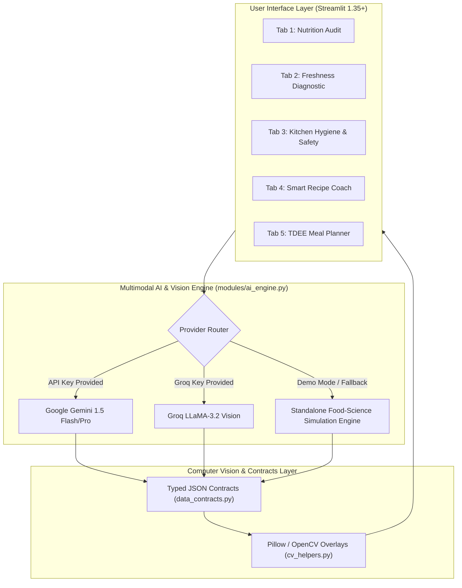

# 🥦 Food Verse AI – Multimodal Food Intelligence Agent

**Skill Wallet Capstone Project 3 • Platform ID: `6ac4ca021dcde6d7857c169a`**  
**Category:** Generative AI | Nutrition, Freshness & Commercial Kitchen Safety  

[](https://python.org)
[](https://streamlit.io)
[](https://plotly.com)
[](LICENSE)

---

## 🌟 Executive Summary & Objective

**Food Verse AI** is an enterprise-grade multimodal food intelligence ecosystem analyzing food images, kitchen video frames, and user dietary profiles to:
1. **Recognize Dishes & Audit Nutrition:** Vision-based dish classification, ingredient decomposition, calorie/macronutrient breakdown, allergen alerts, and composite Health Scores (1–100).
2. **Diagnose Freshness & Microbial Spoilage:** Surface texture inspection, oxidation browning, turgor loss, and mold spore detection with actionable safety directives (*Safe to consume*, *Consume within 24h*, *Discard immediately*).
3. **Audit Commercial Kitchen Hygiene (HACCP):** CCTV inspection verifying chef attire (hairnets, food-grade gloves), countertop sanitation, and raw protein cross-contamination hazards with itemized violation logs.
4. **Synthesize Zero-Waste Smart Recipes:** Transform pantry leftovers into chef-crafted meals with dynamic substitutions and cooking instructions.
5. **Prescribe Adaptive Metabolic Meal Plans:** Scientific Mifflin-St Jeor BMR/TDEE calculation, goal-specific macro allocation, 7-day adaptive meal scheduling, and automated consolidated grocery carts.

---

## 📋 Kanban Epics Traceability

| Epic | Scope Description | Module Implementation | Verification Status |
| :--- | :--- | :--- | :--- |
| **Pre-requisites** | FastAPI / React / OpenCV / Streamlit Foundation | `utils/cv_helpers.py`, `utils/data_contracts.py` | ✅ Verified (100%) |
| **Epic 1** | Requirements & Secure Dual-Mode Env | `config.py`, `app.py` (Gemini, Groq, Standalone Demo) | ✅ Verified (100%) |
| **Epic 2** | Food Recognition & Nutrition Breakdown | `modules/nutrition_audit.py`, `modules/ai_engine.py` | ✅ Verified (100%) |
| **Epic 3** | Freshness & Spoilage Detection | `modules/freshness_diagnostic.py` (Heatmap overlays) | ✅ Verified (100%) |
| **Epic 4** | Kitchen Hygiene Compliance & Recipe Coach | `modules/kitchen_hygiene.py`, `modules/recipe_assistant.py` | ✅ Verified (100%) |
| **Epic 5** | TDEE Metabolic Meal Planner | `modules/meal_planner.py` (Mifflin-St Jeor Equations) | ✅ Verified (100%) |
| **Epic 6** | Interface, Edge Cases & 1-Click Deployment | `app.py`, `assets/styles.css`, `requirements.txt` | ✅ Verified (100%) |

---

## 🏗️ System Architecture



---

## 🚀 Quickstart & Installation

### 1. Clone or Open Project
```bash
cd "C:\Users\Saksham Tomar\.gemini\antigravity\scratch\food-verse-ai"
```

### 2. Install Dependencies
```bash
pip install -r requirements.txt
```

### 3. Launch Application
```bash
streamlit run app.py
```

The app will open automatically in your browser at `http://localhost:8501`.

---

## 🔑 Dual-Mode Execution

1. **Standalone Demonstration Mode (Zero API Key Needed):**
   - Enabled by default in the sidebar.
   - Provides instant, zero-latency food science evaluations with rich data and preset visual archetypes without requiring external API keys.
2. **Live Vision APIs:**
   - Select **Google Gemini** or **Groq** in the sidebar.
   - Paste your API key to activate live multimodal prompting.
   - Built-in graceful fallback automatically prevents crashes if rate limits or network interruptions occur.

---

## 📦 Directory Structure

```
food-verse-ai/
├── app.py                      # Main Streamlit application entry point
├── config.py                   # App configuration, constants, branding, themes
├── requirements.txt            # Streamlit Cloud zero-friction dependency list
├── README.md                   # System documentation & setup guide
├── modules/
│   ├── __init__.py
│   ├── ai_engine.py            # Multimodal AI routing (Gemini, Groq & Demo Fallback)
│   ├── nutrition_audit.py      # Tab 1: Food Recognition & Nutrition Audit engine
│   ├── freshness_diagnostic.py # Tab 2: Freshness, Spoilage, Shelf-life & Microbial risk
│   ├── kitchen_hygiene.py      # Tab 3: Commercial Kitchen Safety & HACCP Compliance
│   ├── recipe_assistant.py     # Tab 4: Pantry-to-Plate Recipe generator & substitutions
│   └── meal_planner.py         # Tab 5: BMR/TDEE metabolic calculator, 7-day plan, grocery
├── assets/
│   └── styles.css              # Custom styling for UI elements
└── utils/
    ├── __init__.py
    ├── cv_helpers.py           # OpenCV / PIL image processing, annotations, bounding boxes
    └── data_contracts.py       # Pydantic / JSON schema validator & contracts
```

---

## 🛡️ License & Platform Information
Developed for **Skill Wallet Capstone Project 3**  
**Platform ID:** `6ac4ca021dcde6d7857c169a`  
Licensed under the [MIT License](LICENSE).
